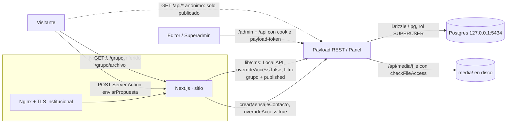

# Informe de auditoría previa al lanzamiento — Plataforma de landings

- **Fecha:** 22-10-2026
- **Alcance:** `proyecto-landings/plataforma` (repositorio sin commits, rama `master`), base de datos local y servidor local (`127.0.0.1`).
- **Marco:** 36 controles del encargo «Auditoría integral de seguridad, privacidad, SEO y calidad previa al lanzamiento».
- **Modo:** solo diagnóstico. No se modificaron código, configuración ni datos persistentes (ver «Efectos secundarios»).
- **Relación con otros documentos:** contrasta y actualiza `docs/PLAN-DE-ACCION.md` (v2, 14-10-2026). Las afirmaciones de ese plan se revalidaron aquí salvo que se indique lo contrario.

## Cómo se obtuvo la evidencia

| Tipo | Detalle |
|---|---|
| Inspección estática | Todo el código propio (`app/`, `components/`, `lib/`, `payload/`, `scripts/`, configuración) y el código fuente instalado de Payload 3.90.2 y `@payloadcms/plugin-multi-tenant` |
| Herramientas del proyecto | `eslint .` (0 errores y 0 avisos), `pnpm build` (correcto, TypeScript incluido), `pnpm test:aislamiento` (**56/56**), `pnpm audit --prod` |
| Sondas HTTP locales | Script de auditoría contra `127.0.0.1:3000`: aislamiento, archivos, REST anónima, cookies, CSRF, cabeceras, 404, metadatos. Todo lo creado se borró |
| Base de datos | Consultas de solo lectura: privilegios del rol, URLs almacenadas, landings y grupos |
| Enlaces | Rastreo interno (71 páginas, 21 imágenes) y una petición por cada uno de los 12 enlaces externos almacenados |

Estados usados: `CUMPLE`, `PARCIAL`, `FALLA`, `PENDIENTE`, `NO APLICA`, `NO INSPECCIONADO`.

---

## 1. Resumen ejecutivo

**Qué es:** un directorio público de grupos de investigación de la FLCH-UNMSM. Cada grupo o subgrupo tiene una landing (`/<grupo>`, `/<grupo>/<subgrupo>`), un archivo de publicaciones (`…/archivo`) y un formulario «Colaborar». Los editores de cada grupo trabajan en un panel común (`/admin`), aislados entre sí.

**Stack:** Next.js 16.3.8 + React 19.2.4, Payload CMS 3.90.2 con `plugin-multi-tenant`, PostgreSQL 16.15 (Drizzle, a través de Payload), sharp 0.35.3 y zod 4.4.3. Funciona solo en localhost: no hay despliegue versionado.

**Datos que trata:**
- Datos de contacto de visitantes: nombre, correo, institución y mensaje.
- Cuentas del panel: correo, hash de contraseña, roles y sesiones.
- Contenido editorial público: integrantes con nombre, foto y biografía.
- Archivos: imágenes y PDF.

**Lo que está bien hecho, verificado en ejecución:**
- Aislamiento entre grupos: 56/56 pruebas. Además, un editor no puede mover un documento a otro grupo ni volver público un archivo privado.
- Un visitante anónimo no puede descargar un archivo privado por su URL.
- El tipo de archivo se valida por su contenido real; se rechazan los SVG y el path traversal.
- No hay SQL crudo, no se inyecta HTML desde el CMS y GraphQL está desactivado.
- Las contraseñas se guardan con PBKDF2-SHA256.
- `forgot-password` no revela si un correo existe.

**No hay vulnerabilidades críticas confirmadas.**

**Lo que impide publicar (P1):**
1. **T-01:** no hay migraciones versionadas. Una instalación limpia en producción no crearía el esquema.
2. **H-06:** el rol de la app en Postgres es `SUPERUSER`, con `CREATEROLE`, `CREATEDB` y `BYPASSRLS`.
3. **H-01:** la cookie de sesión no lleva `Secure`, y se acepta con un `Origin` ajeno.
4. **H-02:** no hay ninguna cabecera de seguridad, y `X-Powered-By` revela el stack.
5. **H-03:** el formulario recoge datos personales sin política de privacidad ni consentimiento.
6. **H-19:** hay 33 landings publicadas con «año de fundación 2026» y grupos «demo». 31 de los 35 grupos no tienen editor, pero su formulario está activo.
7. **H-04 y H-21:** el límite de envíos del formulario se puede saltar. El login solo bloquea por cuenta, y el panel no tiene 2FA ni restricción de red.
8. **H-05:** 5 avisos altos en dependencias de producción (`sharp`, `undici`, `braces`).

**Lo que no se puede resolver sin el entorno real:** TLS/HSTS y proxy, cookie `Secure` servida por HTTPS, rendimiento medido, pruebas en móvil y con lector de pantalla, vista previa en redes sociales, SMTP, cifrado de disco y backups.

### Conclusión: **NO APTO** en el estado actual

No es por una vulnerabilidad explotable grave. Es porque faltan requisitos esenciales para publicar: esquema reproducible, privilegios mínimos en la BD, HTTPS y cookies seguras, cabeceras, base legal del formulario y depuración del contenido de demostración. Con los P1 cerrados y verificados en el entorno real, pasaría a **APTO CON CONDICIONES**.

---

## 2. Inventario técnico y arquitectura

| Ámbito | Evidencia |
|---|---|
| Lenguaje y herramientas | TypeScript 5.7.3 `strict`, ESM, ESLint 9 (`eslint-config-next`) |
| Paquetes | pnpm 11.24.0, `pnpm-lock.yaml`, versiones exactas; `allowBuilds` limita los scripts de instalación |
| Frontend y backend | Next 16.3.8 (Turbopack). Grupo `(sitio)`: público, SSR bajo demanda con `connection()`. Grupo `(payload)`: panel y REST |
| CMS | Payload 3.90.2 + `plugin-multi-tenant` (tenants = `grupos`); campos de texto plano (Lexical solo porque Payload lo exige) |
| Base de datos | Postgres 16.15 en Docker, solo `127.0.0.1:5434`; acceso exclusivo por Payload/Drizzle; 0 consultas crudas en el código propio |
| Autenticación | Payload local auth en `usuarios`: cookie `payload-token` (`HttpOnly`, `SameSite=Lax`, **sin `Secure`**), sesiones en servidor, token de 8 h, bloqueo tras 5 intentos durante 10 min |
| APIs | REST de Payload `/api/*`, Server Functions del panel y una Server Action pública `enviarPropuesta` |
| Archivos | Colección `media`, `staticDir: media/` (no existe `public/`), servida por `/api/media/file/*` con control de acceso. Tipos: JPEG, PNG, WebP, GIF y PDF. 26 archivos, 2,7 MB en total, el mayor de 394 KB; en el sitio público, 21 imágenes con 1,7 MB en total |
| Caché | `unstable_cache` por grupo (`g:<id>`, `grupos`, `directorio`) con `revalidateTag` en los hooks |
| Integraciones | Google Fonts vía `next/font` (autoalojadas). Sin correo (adaptador de consola), sin pagos, sin analítica |
| Infraestructura y CI/CD | **No existe en el repositorio**: sin Dockerfile de la app, Nginx, systemd, CI ni migraciones |
| Logs y auditoría | `console.error` sin datos personales; colección `registro-cambios` con hashes antes y después |
| Pruebas | `scripts/test-aislamiento.ts` (Local API + HTTP) |

Las líneas continuas están confirmadas en el código. El bloque `No_versionado_inferido` procede del README y del plan, sin archivos que lo respalden.

**Rutas:**
- **Públicas:** `/`, `/[grupo]`, `/[grupo]/archivo`, `/[grupo]/[subgrupo]`, `/[grupo]/[subgrupo]/archivo` y la Server Action.
- **Autenticadas:** `/admin/*` y la REST de escritura.
- **Anónimas en la REST** (verificado): lectura de lo publicado en `integrantes`, `grupos`, `media` y `landing`; `/api/access`, `/api/usuarios/me` e `/api/usuarios/init`, que devuelven 200; `login` y `forgot-password`.
- **Denegadas al anónimo:** `usuarios`, `mensajes`, `registro-cambios` y `versions` (403).

**Funcionalidades detectadas:**
- Login y logout, bloqueo por intentos, recuperación de contraseña (sin SMTP no envía nada).
- Roles `superadmin` y `editor`; editores multi-tenant.
- CRUD de landing, integrantes, publicaciones, actividades, agenda, archivos, mensajes, grupos y usuarios.
- Borradores y versiones; visibilidad de archivos calculada automáticamente; registro de cambios.
- Búsqueda y filtros en el navegador; formulario de contacto.
- Scripts de semilla e importación.

**Lo que no hay:** registro público, pagos, analítica, comentarios ni cookies para visitantes.

### Discrepancias entre la documentación y el código

| Documento | Afirma | Realidad |
|---|---|---|
| README:104 | «Cada escritura queda registrada» | `grupos` y `usuarios` no tienen hooks de registro, y `mensajes` no registra su borrado (H-11) |
| PLAN-DE-ACCION 2.6 | `PAYLOAD_SECRET \|\| ''` es un riesgo | Payload aborta al arrancar si el secreto está vacío (`payload/dist/index.js:318`). Solo falta validar la longitud (H-20) |
| PLAN-DE-ACCION 9.4 | Falta un CTA en el Hero | Ya existe: `components/landing/Hero.tsx:45` |
| PLAN-DE-ACCION H16 | El editor ve a otros usuarios | El código lo permite, pero con los datos actuales cada editor solo se ve a sí mismo (H-10, informativo) |

---

## 3. Datos tratados y límites de confianza

| Dato | Origen → validación → autorización → procesamiento → almacenamiento → acceso → eliminación |
|---|---|
| Mensaje de contacto (datos personales) | Navegador → campo trampa + límite en memoria (H-04) + zod en el servidor → grupo resuelto en el servidor (`grupoPorRuta`, solo grupos activos) → `crearMensajeContacto` con `overrideAccess:true` → tabla `mensajes` → editores del grupo y superadmin; el editor puede alterarlo por REST (H-08) → **sin política de conservación (D4)**; solo el superadmin borra, y el borrado no se registra (H-11) |
| Cuenta del panel | Superadmin → validación de Payload (sin política de contraseñas) → `soloSuperadmin`; `roles` y grupos protegidos por campo → hash PBKDF2-SHA256 con sal → `usuarios` → el propio usuario y el superadmin → borrado por el superadmin, sin registro (H-11) |
| Contenido editorial | Editor → validación por campo + `exigirMismoGrupo` → plugin multi-tenant → borradores y versiones → tablas de contenido → público solo `published` (`lib/cms` y REST anónima) → borrado por el editor, registrado |
| Archivos | Editor → MIME por contenido (`file-type`), máximo 20 MB → plugin → sin derivadas → `media/` en disco → anónimo solo si `visibilidad = publica` → borrado por el editor; **sin backups** |
| Sesión | Login → `payload-token` (HttpOnly, Lax, sin Secure) → sesión en BD → 8 h → invalidada al cerrar sesión |
| Secretos técnicos | `.env` y `.env.credenciales`, ignorados por git → solo en el servidor → sin rastro en `.next/static` ni source maps |

**Límites de confianza:**
- Navegador ↔ Next (Server Action, REST anónima).
- Panel ↔ REST autenticada.
- App ↔ Postgres, con rol superusuario.
- App ↔ disco `media/`.

**Zonas sin información:** proxy, TLS, backups y servidor de producción.

---

## 4. Matriz de los 36 controles

| ID | Categoría | Control | Aplica | Estado | Sev. | Evidencia | Riesgo | Recomendación |
|---|---|---|---|---|---|---|---|---|
| 01 | Seguridad | API keys y secretos | Sí | CUMPLE | — | Solo `process.env`; única variable pública: `NEXT_PUBLIC_SITE_URL`. En `.next/static` no aparecen nombres de variables privadas ni `postgres://`, y no hay `.map` | — | Repetir la búsqueda en el build de producción; validar la longitud del secreto (H-20) |
| 02 | Seguridad | Secretos en Git | Sí | CUMPLE | — | `.gitignore` cubre `.env`, `.env.*` y `media/`; `git status --ignored` lo confirma; 0 commits | Primer commit sin escaneo previo | Escanear secretos antes del primer commit. Repo de Strapi: NO INSPECCIONADO |
| 03 | Seguridad | Credenciales de BD | Sí | FALLA | Media | Postgres solo en loopback, sin exposición al cliente. `pg_roles`: `plataforma` con `rolsuper`, `rolcreaterole`, `rolcreatedb` y `rolbypassrls` = `t` | Un fallo en la app daría control total del clúster | H-06 |
| 04 | Seguridad | RLS / aislamiento | Sí (equivalente) | CUMPLE | — | Sin RLS de Postgres; mecanismo equivalente en la app (plugin + `exigirMismoGrupo` + `lib/cms`). 56/56 pruebas; cambio de grupo de un documento propio rechazado (400) | No hay defensa a nivel de BD | Mantener las pruebas en CI. RLS: decisión P2 |
| 05 | Seguridad | Autenticación obligatoria | Sí | PARCIAL | Media | Escrituras solo con sesión; anónimo solo lo publicado (verificado). Sin 2FA; panel sin restricción de red | Panel expuesto a Internet con solo contraseña | H-21 |
| 06 | Seguridad | Autorización / IDOR | Sí | CUMPLE | — | Lectura, edición y borrado por id entre grupos rechazados (Local API y REST); usuarios, mensajes y registro de cambios cerrados al anónimo | Exposición potencial de usuarios con grupo en común (H-10) | Decidir D11 |
| 07 | Seguridad | Campos protegidos | Sí | PARCIAL | Baja | `roles`, grupos del usuario, `visibilidad` (verificado: el PATCH no cambia nada) y `ruta` protegidos. `mensajes` solo tiene `admin.readOnly` | Un editor altera mensajes por REST | H-08 |
| 08 | Seguridad | Cookies y sesiones | Sí | FALLA | Media | `Set-Cookie` real: `HttpOnly=true; SameSite=Lax`, **sin `Secure`**. Con la cookie y `Origin: https://evil.example`, `/me` devuelve el usuario | Cookie enviada por HTTP; sin segunda barrera CSRF | H-01 |
| 09 | Seguridad | Contraseñas | Sí | PARCIAL | Baja | `pbkdf2-sha256-v1` con sal (`generatePasswordSaltHash.js`); bloqueo tras 5 intentos. Sin política de longitud ni de contraseñas comunes | Contraseñas débiles | Mínimo de 12 caracteres + lista de contraseñas comunes |
| 10 | Seguridad | Cifrado | Sí | PENDIENTE | — | No hay TLS, cifrado de disco ni backups versionados | Datos de contacto en claro en disco y en backups | Coordinar con TI; backups cifrados |
| 11 | Seguridad | HTTPS | Sí | PENDIENTE | — | No hay configuración de proxy ni TLS en el repositorio | — | Plantilla de Nginx (301, `default_server`) y prueba en la VM |
| 12 | Seguridad | Cabeceras de seguridad | Sí | FALLA | Media | Ninguna cabecera de seguridad en `/`, landing, `/admin` ni `/api`; `X-Powered-By: Next.js, Payload` | Clickjacking del panel, sniffing de MIME, huella del stack | H-02 |
| 13 | Seguridad | Validación y sanitización | Sí | CUMPLE | — | zod en el servidor (`acciones.ts:12-18`), URLs `^https?://` (`contenido.ts:13`), slug y rutas reservadas; React escapa la salida; único `dangerouslySetInnerHTML` = constante (`Hero.tsx:37`) | Textos del CMS sin `maxLength` (solo editores autenticados) | Límites de longitud (P3) |
| 14 | Seguridad | Consultas parametrizadas | Sí | CUMPLE | — | 0 apariciones de `sql\``, `sql.raw`, `.execute(` o `drizzle` en el código propio | — | Regla en CI que lo detecte |
| 15 | Abuso | Rate limiting | Sí | PARCIAL | Media | `acciones.ts:21-37`: `Map` sin tope, clave = primer valor de `X-Forwarded-For`. Login: bloqueo solo por cuenta | Saltarse el límite, crecimiento de memoria, bloqueo de cuentas | H-04, H-21 |
| 16 | Abuso | Bots y spam | Sí | PARCIAL | Baja | Solo campo trampa (`Colaborar.tsx:75`) | Spam a los grupos | Marca de tiempo firmada y estado «posible spam»; CAPTCHA solo si persiste |
| 17 | Abuso | Restricción de archivos | Sí | PARCIAL | Baja | MIME falso y SVG rechazados; archivo privado → 403; traversal → 403. Límite genérico de 20 MB y 3 archivos; respuestas sin `nosniff` ni `Cache-Control` | Consumo de disco; PDF activo en el mismo origen | H-12 |
| 18 | Abuso | Dependencias | Sí | FALLA | Media | `pnpm audit --prod`: 16 avisos (5 altos, 6 moderados, 5 bajos, 0 críticos) | Explotación en el procesado de imágenes (solo editores) | H-05 |
| 19 | Abuso | Minimización de datos | Sí | PARCIAL | Baja | `lib/cms` devuelve objetos mínimos. La REST anónima devuelve documentos completos de lo publicado (35 landings, 35 grupos); `/api/access` revela la estructura de permisos | Extracción masiva y metadatos innecesarios | H-09 |
| 20 | Privacidad | Política de privacidad | Sí | FALLA | Alta | No hay ruta ni enlace; el formulario recoge datos personales | Incumplir el deber de información (Ley 29733; requiere revisión jurídica) | H-03 |
| 21 | Privacidad | Términos y condiciones | Sí | FALLA | Baja | No existen | Poco, sin usuarios públicos registrados | Borrador para revisión jurídica (D2) |
| 22 | Privacidad | Cookies y consentimiento | No, por ahora | NO APLICA | — | El código del sitio no pone cookies a visitantes; sin analítica ni scripts de terceros; la del panel es esencial | — | Reevaluar si D7 añade analítica |
| 23 | SEO | Metadatos | Sí | PARCIAL | Baja | Landing: `<title>` y `description`. `/` sin descripción; sin canonical | Fragmentos pobres en buscadores | H-14 |
| 24 | SEO | Sitemap XML | Sí | FALLA | Baja | `GET /sitemap.xml` → 404 | Indexación lenta | H-14 |
| 25 | SEO | robots.txt | Sí | FALLA | Baja | `GET /robots.txt` → 404 | Rastreo de `/api` y `/admin` (no es un control de seguridad) | H-14 |
| 26 | SEO | Texto alternativo | Sí | CUMPLE | — | `alt` obligatorio en `media`; retratos decorativos con `alt=""` dentro de un botón con `aria-label` | Texto de placeholder visible («foto del grupo») | Ajustar placeholders (P3) |
| 27 | Rendimiento | Optimización de imágenes | Sí | PARCIAL | Baja | `images.unoptimized`; sin `imageSizes`; Hero en `loading="lazy"`. Medido: 21 imágenes con 1,7 MB, la mayor de 328 KB | LCP penalizado en móvil | H-13 |
| 28 | Rendimiento | Velocidad de carga | Sí | PENDIENTE | — | Sin Lighthouse. Medido: HTML de la landing de 115 KB; caché por grupo correcta; 3 familias tipográficas | Caché en disco sin límite (H-22) | Lighthouse; H-22 |
| 29 | Rendimiento | Adaptación a móviles | Sí | PARCIAL | Baja | Media queries presentes; enlaces de sección ocultos bajo 1200 px sin menú alternativo (`Nav.module.css:47-49`) | Navegación limitada en móvil | H-15 |
| 30 | Rendimiento | Contraste y accesibilidad | Sí | PARCIAL | Baja | Tokens de alto contraste; `<dialog>` nativo con foco devuelto; `aria-pressed` y `aria-live`. Errores del formulario no asociados a los campos; `input:focus{outline:none}`; sin «saltar al contenido» | Barreras para lectores de pantalla | H-16, H-23 |
| 31 | Rendimiento | Página 404 | Sí | PARCIAL | Baja | `/no-existe` → 404 con diseño del sitio y `noindex`. `/a/b/c`, `/litartmo/archivo/x` → 404 con la página por defecto de Next. Sin `error.tsx` | Experiencia inconsistente; error 500 sin diseño | H-17 |
| 32 | Rendimiento | Enlaces rotos | Sí | PARCIAL | Baja | Interno: 71 páginas y 21 imágenes sin rotos. Externo: los 11 enlaces reales → 200. El aliado CEDOC tenía una URL de relleno, ya vaciada en la semilla. 7 actividades apuntan al sitio que se retirará | Enlaces que se romperán | H-18 |
| 33 | Formularios | Validación de formularios | Sí | PARCIAL | Baja | Cliente: `required` y `type=email`; servidor: zod; botón desactivado mientras envía. Sin `maxLength` en el cliente; un solo mensaje de error no asociado; posible pérdida de lo escrito (hipótesis) | Abandono, accesibilidad | H-16 |
| 34 | Formularios | Analítica GA4 | No | NO APLICA | — | Sin `gtag` ni analítica en el código | — | Solo con D7 y Consent Mode |
| 35 | Formularios | Llamadas a la acción | Sí | PARCIAL | Baja | CTA en el Hero (`Hero.tsx:45`) y en el menú de escritorio. «Le escribiremos» se promete también en los 31 grupos sin editor | Expectativa incumplida | H-15, H-19 |
| 36 | Formularios | Vista previa al compartir | Sí | FALLA | Baja | La landing solo tiene `description`; sin `og:*`, `twitter:*` ni favicon (`/favicon.ico` → 404); `metadataBase` sí existe | Enlaces compartidos sin imagen ni descripción | H-14 |

---

## 5. Registro de hallazgos

Ordenados por prioridad.

### T-01 · No hay migraciones versionadas
- **Control:** transversal (despliegue); condiciona el 03.
- **Severidad / prioridad:** Alta (disponibilidad) · P1.
- **Estado:** confirmado.
- **Evidencia:** no existe `migrations/` y `payload.config.ts:29` no fija `push:false`. Al ejecutar `payload run`, Drizzle sincroniza el esquema con la BD («Pulling schema from database…»).
- **Escenario:** con `NODE_ENV=production` no hay `push`, así que una instalación limpia no crea las tablas. Sin migraciones tampoco se puede separar el rol dueño del rol de la app.
- **Corrección:** `payload migrate:create` (migración base), `push:false` y un script `pnpm migrate`.
- **Prueba de aceptación:** instalación limpia en una BD de auditoría, seguida de `test:aislamiento` en verde.
- **Efecto secundario:** la migración base tiene que reproducir exactamente el esquema actual.

### H-06 · El rol de la app en Postgres es superusuario
- **Control:** 03.
- **Severidad / prioridad:** Media · P1.
- **Estado:** confirmado el 22-10.
- **Evidencia:** `pg_roles` → `plataforma`: `rolsuper=t`, `rolcreaterole=t`, `rolcreatedb=t`, `rolbypassrls=t`.
- **Escenario:** cualquier fallo futuro de la app (RCE, inyección) hereda control total del clúster: archivos del servidor, creación de roles, etc.
- **Corrección:** `plataforma_owner` para migraciones y `plataforma_app` sin atributos, con `SELECT/INSERT/UPDATE/DELETE`, `USAGE` en secuencias y `ALTER DEFAULT PRIVILEGES`. Depende de T-01.
- **Prueba de aceptación:** `\du` sin atributos para la app; `CREATE TABLE` y `DROP TABLE` como app fallan; `test:aislamiento` en verde.

### H-01 · Cookie sin `Secure` y CSRF sin lista de orígenes
- **Controles:** 08 y 11.
- **Severidad / prioridad:** Media · P1.
- **Estado:** confirmado en ejecución.
- **Evidencia:** `Set-Cookie: payload-token=…; HttpOnly=true; SameSite=Lax`, sin `Secure`. Valores por defecto de Payload (`collections/config/defaults.js:121-122`); `csrf: []` y sin `serverURL` (`config/defaults.js:44-45`). Con la cookie y `Origin: https://evil.example`, `/api/usuarios/me` devuelve el usuario.
- **Escenario:** si el panel responde por HTTP (antes de la redirección, o con HSTS mal puesto), la cookie viaja en claro. Contra peticiones entre sitios solo protege `SameSite=Lax`.
- **Corrección:** `auth.cookies.secure` en producción, y `serverURL` desde `NEXT_PUBLIC_SITE_URL` (Payload añade ese origen a `csrf`). Evaluar `SameSite=Strict` con la matriz de flujos del panel.
- **Prueba de aceptación:** por HTTPS, la cookie incluye `Secure`; con un `Origin` ajeno no hay sesión.
- **Efecto secundario:** un `serverURL` incorrecto rompe el login.

### H-02 · No hay cabeceras de seguridad
- **Control:** 12.
- **Severidad / prioridad:** Media · P1.
- **Estado:** confirmado en ejecución.
- **Evidencia:** `next.config.mjs` sin `headers()` ni `poweredByHeader:false`; no hay `proxy.ts`. Las respuestas no llevan CSP, HSTS, XFO, nosniff, Referrer-Policy ni Permissions-Policy, y sí llevan `X-Powered-By: Next.js, Payload`.
- **Escenario:** el panel se puede enmarcar (clickjacking), el navegador puede interpretar mal el tipo MIME y el stack queda expuesto.
- **Corrección:**
  - `X-Content-Type-Options`, `Referrer-Policy`, `Permissions-Policy`, `frame-ancestors 'none'` / `X-Frame-Options` y `poweredByHeader:false`.
  - CSP primero en `Report-Only`, con nonce por petición en `proxy.ts`, separada para el sitio y para `/admin`. El script del typewriter (`Hero.tsx:37`) necesita nonce o hash.
  - HSTS en Nginx.
- **Prueba de aceptación:** `curl -I` en `/`, una landing, `/admin` y `/api/media/file/…` muestra las cabeceras sin duplicados y sin infracciones de CSP.
- **Efecto secundario:** una CSP aplicada antes de tiempo rompe el panel (Monaco, estilos en línea).

### H-03 · Datos personales sin política ni consentimiento
- **Controles:** 20, 21 y 33.
- **Severidad / prioridad:** Alta (cumplimiento) · P1.
- **Estado:** confirmado.
- **Bloqueado por:** decisiones D2 y D4.
- **Evidencia:** `Colaborar.tsx:52-73` recoge nombre, correo, institución y mensaje. `Footer.tsx` no tiene enlaces legales. No hay política de conservación.
- **Escenario:** la universidad, como responsable, trata datos personales sin cumplir el deber de información (Ley 29733 y su Reglamento). La conclusión jurídica corresponde a asesoría legal.
- **Corrección:** `/privacidad` y `/terminos` aprobadas; casilla de consentimiento obligatoria; fecha y versión aceptada guardadas en `mensajes`; añadir esas rutas a `RUTAS_RESERVADAS`.
- **Prueba de aceptación:** enviar sin aceptar produce un error accesible; el mensaje guardado incluye la versión aceptada.

### H-19 · Contenido ficticio o inventado publicado y formularios sin destinatario
- **Controles:** 35 y 20.
- **Severidad / prioridad:** Media · P1.
- **Estado:** confirmado en la BD local.
- **Evidencia:**
  - 33 landings publicadas con `anio_fundacion = 2026`, incluidas `estudios-andinos-demo` y `litartmo/subgrupo-demo`.
  - 31 de 35 grupos sin editor asignado.
  - Origen: `scripts/importar-grupos-2026.ts:74,83` y `scripts/seed.ts`. El directorio público enlaza 33 grupos y muestra contenido «demo».
- **Escenario:** el público ve cifras falsas («Año de fundación 2026») y grupos de prueba. Los visitantes envían datos personales a grupos sin editor, con la promesa de «Le escribiremos».
- **Corrección:** no cargar la semilla demo en producción. Landings mínimas sin cifra de fundación y sin formulario (o como borrador) hasta que el grupo tenga editor.
- **Prueba de aceptación:** el directorio de producción no muestra nada «demo»; un grupo sin editor no muestra el formulario.

### H-04 · Límite de envíos del formulario eludible y sin tope
- **Control:** 15.
- **Severidad / prioridad:** Media · P1.
- **Estado:** confirmado por código.
- **Evidencia:** `app/(sitio)/[grupo]/acciones.ts:21-28,36`.
- **Escenarios:**
  1. Un bot rota `X-Forwarded-For` en cada petición, se salta el límite y hace crecer el `Map` sin límite.
  2. Sin proxy, todas las peticiones caen en la clave `'local'`: 3 envíos por minuto para todo el sitio.
- **Corrección:** IP de confianza solo detrás del proxy (Nginx sobrescribe la cabecera); clave IP+grupo; estructura con tope y barrido; `limit_req` en Nginx para los POST con `Next-Action`.
- **Prueba de aceptación:** una cabecera falsificada no cambia la clave; la memoria se mantiene estable con 100 000 IP falsas.
- **Efecto secundario:** un límite mal calibrado bloquea a usuarios detrás de NAT institucional.

### H-21 · Panel protegido solo por contraseña; bloqueo de cuentas por terceros
- **Controles:** 05 y 15.
- **Severidad / prioridad:** Media · P1.
- **Estado:** confirmado por código.
- **Bloqueado por:** decisión D3.
- **Evidencia:** `payload/collections/plataforma.ts:77` (`maxLoginAttempts: 5`, por cuenta). No hay límite por IP ni 2FA.
- **Escenario:** conociendo el correo de un editor, un tercero mantiene su cuenta bloqueada indefinidamente; el panel queda expuesto a ataques de contraseñas.
- **Corrección:** `/admin` y las rutas de autenticación y escritura de `/api` solo desde la red o VPN institucional (manteniendo público `/api/media/file/`); `limit_req` en `login` y `forgot-password`.
- **Prueba de aceptación:** desde una IP externa, `/admin` → 403 y las imágenes públicas → 200.

### H-05 · Dependencias de producción con avisos
- **Control:** 18.
- **Severidad / prioridad:** Media · P1.
- **Estado:** confirmado el 22-10.

| Paquete | Severidad | Ruta | Tratamiento |
|---|---|---|---|
| `sharp` 0.35.3 | 2 altas (libheif, librsvg) | directa | Subir a 0.35.5 y probar subidas JPEG, PNG, WebP y GIF |
| `undici` 7.29.0 | 2 altas, 4 moderadas, 3 bajas | `payload` la fija exacta | Override acotado `payload>undici` ≥ 7.29.1 |
| `braces` 3.0.3 | 1 alta (DoS) | `@payloadcms/ui > next > sass > chokidar` | Sin versión corregida: excepción con fecha de revisión (patrones no controlados por usuarios) |
| `esbuild` ≤ 0.24.2 | 1 moderada | `drizzle-kit` (solo servidor de desarrollo) | Excepción con fecha de revisión |
| `dompurify` ≤ 3.4.15 | 2 bajas (modo `IN_PLACE`) | `monaco-editor` (solo panel) | Excepción si Monaco no usa `IN_PLACE`; si lo usa, override |

- **Explotabilidad reducida:** solo editores autenticados suben archivos, y HEIF y SVG no están entre los tipos permitidos.
- **Prueba de aceptación:** `pnpm audit --prod` sin avisos altos que no tengan excepción aprobada y fechada; build y pruebas en verde.

### H-22 · La caché en disco crece con cada URL inexistente
- **Control:** 28.
- **Severidad / prioridad:** Media · P2.
- **Estado:** confirmado en ejecución.
- **Evidencia:** `lib/cms/index.ts:130` usa la ruta de la URL como clave de `unstable_cache`. 40 peticiones a rutas aleatorias crearon 40 archivos nuevos (~109 B cada uno) en `.next/cache/fetch-cache/`, que no se eliminan.
- **Escenario:** muchas peticiones a URLs aleatorias acumulan millones de archivos y agotan inodos o disco, con lo que el sitio cae.
- **Corrección:** validar la ruta (formato de slug, máximo 2 segmentos) antes de consultar la caché, o no cachear los resultados nulos; `limit_req` en Nginx; vigilar el tamaño de `.next/cache`.
- **Prueba de aceptación:** 1000 rutas aleatorias no aumentan el número de archivos de caché.

### H-08 · Un editor puede alterar los mensajes recibidos por REST
- **Control:** 07.
- **Severidad / prioridad:** Baja · P2.
- **Estado:** confirmado por código (no había mensajes en la BD para probarlo).
- **Evidencia:** `payload/collections/plataforma.ts:134-141`: `update: usuarioDelPanel` y `admin.readOnly`, que solo afecta a la interfaz.
- **Impacto:** integridad de los mensajes dentro del propio grupo. Queda constancia (solo hashes) en `registro-cambios`.
- **Corrección:** `access.update: () => false` en `nombre`, `correo`, `institucion`, `tipo` y `mensaje`; solo `estado` editable.
- **Prueba de aceptación:** un PATCH sobre esos campos no cambia nada al releer de la BD.

### H-11 · El registro de cambios está incompleto
- **Controles:** 10 y 19.
- **Severidad / prioridad:** Baja · P2.
- **Estado:** confirmado por código.
- **Evidencia:** `Grupos` y `Usuarios` no tienen hooks de registro (`payload/collections/plataforma.ts:30,74-100`); `Mensajes` no tiene `afterDelete`. Contradice el README:104.
- **Impacto:** los cambios de roles o grupos y el borrado de mensajes no dejan rastro.
- **Corrección:** añadir `registrarCambio` y `registrarBorrado`.

### H-12 · Límites de subida genéricos y archivos sin cabeceras
- **Control:** 17.
- **Severidad / prioridad:** Baja · P2.
- **Estado:** confirmado.
- **Evidencia:** valores por defecto de Payload: 20 MB por archivo y 3 archivos (`uploads/fetchAPI-multipart/index.js:12-16`). Las respuestas de `/api/media/file` no llevan `X-Content-Type-Options` ni `Cache-Control`.
- **Corrección:** `upload.limits.fileSize` global; hook en `media` con límite por tipo (imagen 5 MB, PDF 20 MB); `modifyResponseHeaders` con `nosniff` y, en PDF, `Content-Security-Policy: sandbox`; `client_max_body_size` en Nginx.

### H-13 · Imágenes originales sin redimensionar y Hero en `lazy`
- **Controles:** 27 y 28.
- **Severidad / prioridad:** Baja · P2.
- **Estado:** confirmado.
- **Evidencia:** `components/landing/Imagen.tsx:7`; `next.config.mjs:7`. Peso medido: 1,7 MB en 21 imágenes, la mayor de 328 KB.
- **Corrección:** `imageSizes` en WebP con `srcset`/`sizes`; prop de prioridad en el Hero (`loading="eager"` y `fetchPriority="high"`). Reprocesar los archivos existentes solo con backup.

### H-14 · SEO y vista previa al compartir incompletos
- **Controles:** 23, 24, 25 y 36.
- **Severidad / prioridad:** Baja · P2.
- **Estado:** confirmado en ejecución.
- **Corrección:**
  - `app/sitemap.ts` con `connection()` + `listarGrupos()`.
  - `app/robots.ts`.
  - `alternates.canonical`, `openGraph` y `twitter` por ruta.
  - `app/icon.*`.
  - Descripción para `/`.

### H-16 · Errores del formulario no accesibles
- **Controles:** 33 y 30.
- **Severidad / prioridad:** Baja · P2.
- **Estado:** confirmado por código; la pérdida de lo escrito sigue siendo una hipótesis.
- **Evidencia:** `components/landing/Colaborar.tsx:76`: un único `
` sin `role="alert"` ni `aria-describedby`.
- **Corrección:** errores por campo, `aria-invalid`, `maxLength` igual a zod y conservar los valores enviados.

### H-18 · Enlaces externos rotos o en riesgo
- **Control:** 32.
- **Severidad / prioridad:** Baja · P2.
- **Bloqueado por:** decisión D9.
- **Evidencia:** 7 actividades apuntan a `prensayliteraturaletras.unmsm.edu.pe`, que hoy responde 200 pero se retirará.
- **Ya corregido:** el aliado «CEDOC - UNMSM» tenía una URL de relleno, no un enlace real. El 22-10 se vació en la semilla (`scripts/semilla/prensa-y-literatura/data/aliados.json:5`), así que la tarjeta se muestra sin enlace. La base de datos local conserva el valor anterior (la semilla no modifica grupos existentes): hay que vaciarlo también desde el panel (Landing → Secciones → Aliados) o en cada entorno donde se cargue.
- **Corrección pendiente:** según D9, crear páginas de detalle propias o retirar los enlaces al sitio antiguo. Cuando exista, poner la URL real del CEDOC.

### H-09 · La REST anónima devuelve documentos completos de lo publicado
- **Control:** 19.
- **Severidad / prioridad:** Baja · P3.
- **Estado:** confirmado.
- **Detalle:** no expone nada que el sitio no muestre ya, pero suma metadatos (`createdAt`, ids, `filename`) y permite extraer todo de forma masiva.
- **Corrección:** distinguir por canal (`req.payloadAPI === 'REST'` para anónimos) y mantener abierto `/api/media/file/`.
- **Riesgo de regresión:** `lib/cms` lee como anónimo por la Local API; cerrar mal la lectura vaciaría el sitio.

### H-15 · Navegación de secciones oculta bajo 1200 px
- **Controles:** 29 y 35.
- **Severidad / prioridad:** Baja · P3.
- **Evidencia:** `components/landing/Nav.module.css:47-49`. Lo atenúa el CTA visible del Hero.
- **Corrección:** menú compacto accesible o barra con «Colaborar».

### H-17 · 404 inconsistente y sin página de error
- **Control:** 31.
- **Severidad / prioridad:** Baja · P3.
- **Estado:** confirmado en ejecución.
- **Evidencia:** las rutas de 3 o más segmentos devuelven la página 404 por defecto de Next. No existen `error.tsx` ni `global-error.tsx`.
- **Corrección:** `app/(sitio)/[grupo]/[...resto]/page.tsx` con `notFound()`, más `error.tsx` y `global-error.tsx` sin trazas.

### H-23 · Foco y teclado
- **Control:** 30.
- **Severidad / prioridad:** Baja · P3.
- **Evidencia:** `app/(sitio)/globals.css:42` quita el outline de los campos (lo compensa el cambio de borde); falta un enlace «Saltar al contenido».

### H-24 · Errata en el nombre del grupo
- **Control:** contenido (afecta al 23).
- **Severidad / prioridad:** Baja · P3.
- **Estado:** confirmado en la BD.
- **Evidencia:** la landing de `litartmo/prensa-y-literatura` tiene `grupo_texto = "Grupo de Investigación LITARMO"`, y la errata aparece en el `<title>`.
- **Corrección:** corregir el dato desde el panel y la fuente de la semilla si procede.

### H-10 · Visibilidad de usuarios entre editores
- **Control:** 06.
- **Severidad / prioridad:** Informativa · P3.
- **Bloqueado por:** decisión D11.
- **Detalle:** el código permite que un editor lea a los usuarios con los que comparte grupo (`Usuarios.read: usuarioDelPanel` + filtro del plugin). Con los datos actuales, cada editor solo se ve a sí mismo.

### H-20 · No se valida la longitud de `PAYLOAD_SECRET`
- **Control:** 01.
- **Severidad / prioridad:** Informativa · P3.
- **Detalle:** si el secreto está vacío, Payload ya aborta al arrancar. Falta exigir 32 caracteres o más sin imprimir el valor.

---

## 6. Plan de remediación por fases

**Fase 0 — Contención:** no hay riesgos activos ni secretos expuestos. Paso previo: escaneo de secretos y primer commit como línea base (D5).

**Fase 1 — Seguridad esencial (P1)**

| Tarea | Resuelve | Archivos | Depende de | Riesgo de regresión | Cierre |
|---|---|---|---|---|---|
| Migración base + `push:false` | T-01 | `migrations/`, `payload.config.ts`, `package.json` | Primer commit | Desfase de esquema | Instalación limpia + `test:aislamiento` en verde |
| Roles de Postgres | H-06 | `deploy/postgres/roles.sql`, `.env.example` | T-01 | Falta de privilegios | `\du` + DDL rechazado + pruebas en verde |
| Cookies, `serverURL`/`csrf`, validación del secreto | H-01, H-20 | `payload.config.ts`, `payload/collections/plataforma.ts` | — | Login roto | Matriz de flujos del panel; `Origin` ajeno sin sesión |
| Cabeceras + CSP en Report-Only + `poweredByHeader:false` | H-02 | `next.config.mjs`, `proxy.ts`, `Hero.tsx` | — | Panel roto por la CSP | Cabeceras presentes y sin duplicados |
| Límite de envíos con IP de confianza y tope | H-04 | `acciones.ts`, `lib/limite.ts`, `deploy/nginx/` | D10 | Bloqueo tras NAT | Pruebas de clave y memoria |
| Restricción de red del panel + `limit_req` en login | H-21 | `deploy/nginx/` | D3 | Bloquear a editores | `/admin` externo → 403 |
| Dependencias | H-05 | `package.json`, `pnpm-lock.yaml` | — | Fallos de sharp | `audit` + build + subida de imágenes |
| Depurar contenido demo y landings automáticas | H-19, H-24 | Datos, `scripts/` | Decisión editorial | — | Directorio de producción sin «demo» ni cifras inventadas |
| Política, términos y consentimiento | H-03 | `app/(sitio)/privacidad`, `terminos`, `mensajes`, `lib/rutas.ts` | D2, D4 | — | Textos aprobados y enlazados; versión guardada |

**Fase 2 — Privacidad y configuración (P2):**
- Campos de `mensajes` protegidos (H-08).
- Registro de cambios completo (H-11).
- Límites y cabeceras de archivos (H-12).
- Caché en disco acotada (H-22).
- HTTPS y HSTS en Nginx (controles 10 y 11).
- Backups cifrados con restauración probada.

**Fase 3 — Calidad de publicación (P2-P3):**
- SEO, Open Graph, sitemap, robots e iconos (H-14).
- Formulario accesible (H-16).
- 404 en todas las rutas y `error.tsx` (H-17).
- Enlaces externos (H-18).
- REST anónima por canal (H-09).

**Fase 4 — Rendimiento y móvil:**
- Imágenes derivadas y prioridad del Hero (H-13).
- Menú móvil (H-15).
- Foco y teclado (H-23).
- Pesos tipográficos.

**Fase 5 — Validación final:**
- `test:aislamiento` ampliado: PATCH de `mensajes`, archivos privados por URL, cambio de grupo, `/api/access`.
- Lighthouse y axe.
- Cabeceras y TLS en el entorno real.
- Revisión del riesgo residual.

---

## 7. Pruebas pendientes

| Prueba | Requiere |
|---|---|
| TLS, cadena del certificado, 301 de HTTP a HTTPS, HSTS, `Host` desconocido | VM de prueba con Nginx (D1, D10) |
| Cookie `Secure` servida por HTTPS | Entorno con TLS |
| Cabeceras efectivas detrás del proxy | VM de prueba |
| Lighthouse / Core Web Vitals | Aprobación para usar Lighthouse; `pnpm start` local o VM |
| Pruebas en móvil (360–768 px) y con NVDA/teclado | Navegador y dispositivo real |
| Vista previa en WhatsApp, X y LinkedIn | Dominio público |
| Recuperación de contraseña de principio a fin y caducidad del enlace | SMTP (D6) |
| Cifrado de disco, backups, firewall y SSH | TI de la VM |
| Escaneo de secretos del repositorio de Strapi | Autorización y acceso a ese repositorio |
| PATCH de los campos de `mensajes` en ejecución | Un mensaje de prueba en la BD local |

---

## 8. Checklist de cierre

- [ ] **T-01:** una instalación limpia crea el esquema con migraciones.
- [ ] **H-06:** la app conecta con un rol sin `SUPERUSER`, `CREATEROLE`, `CREATEDB` ni `BYPASSRLS`.
- [ ] **H-01:** por HTTPS la cookie lleva `Secure`; un `Origin` ajeno no obtiene sesión.
- [ ] **H-02:** las cabeceras de seguridad están presentes y sin duplicados; la CSP está aplicada sin infracciones; no aparece `X-Powered-By`.
- [ ] **Controles 10 y 11:** 301 a HTTPS, HSTS y TLS válidos en el entorno real.
- [ ] **H-04 y H-21:** el límite de envíos no se puede eludir; el panel está restringido por red.
- [ ] **H-05:** `pnpm audit --prod` sin avisos altos que no tengan excepción aprobada y fechada.
- [ ] **H-03:** política y consentimiento aprobados por escrito (responsable: D2) y enlazados.
- [ ] **H-19 y H-24:** sin contenido demo, cifras inventadas ni erratas en producción.
- [ ] `test:aislamiento` ampliado y en verde.
- [ ] Backup y restauración probados.
- [ ] Riesgos aceptados documentados, con responsable (no consta en el repositorio; hay que designarlo):
  - [ ] H-09.
  - [ ] Excepciones de dependencias: `braces`, `esbuild` y `dompurify`.
  - [ ] RLS de Postgres.

Ningún control `PENDIENTE` figura como aprobado.

---

## 9. Efectos secundarios de la auditoría

- Se regeneró `.next/` con un build nuevo, ignorado por git.
- Quedaron unos 40 archivos de caché de ~109 B, de la prueba de H-22, en `.next/cache/fetch-cache/`.
- `registro-cambios` tiene entradas de los documentos temporales de las pruebas. Esos documentos ya están borrados.
- La cuenta `editor-demo@plataforma.local` tiene un token de recuperación de contraseña pendiente. Caduca solo y la contraseña no cambió.
- Al ejecutar `payload run`, Drizzle sincronizó el esquema en modo desarrollo; no se observaron cambios.
- No se imprimieron ni copiaron secretos. Las credenciales locales se leyeron solo dentro de los scripts de prueba.
- La base de datos ya estaba en marcha al empezar y se dejó así. El servidor de pruebas se detuvo.
